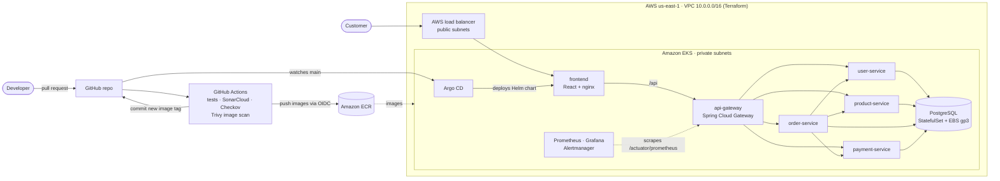

# CloudForge – Internal Developer Platform

CloudForge is a cloud-native platform that takes application code from a developer's commit to a
running, monitored service on AWS – automatically built, tested, security-scanned and deployed.
It is demonstrated with **VoltCart**, a multi-service e-commerce shop.

```
git push ─► GitHub Actions ─► tests · SonarCloud · Trivy ─► Amazon ECR ─► Git (image tag) ─► Argo CD ─► Amazon EKS
                                                                                                │
                                                                       Prometheus · Grafana · alerts ◄┘
```

## Architecture



More detail: [docs/architecture.md](docs/architecture.md).

## VoltCart – the demo application

| Component | Technology | Responsibility |
|---|---|---|
| `frontend` | React 18 + Vite, served by non-root nginx | Shop UI; nginx proxies `/api` to the gateway |
| `api-gateway` | Spring Cloud Gateway (WebFlux) | Single entry point, routes `/api/<service>/**` |
| `user-service` | Spring Boot 3.5, Java 21 | Customers (`users_db`) |
| `product-service` | Spring Boot 3.5, Java 21 | Catalogue and stock (`products_db`) |
| `order-service` | Spring Boot 3.5, Java 21 | Places orders: checks user → reserves stock → takes payment → releases stock if payment fails (`orders_db`) |
| `payment-service` | Spring Boot 3.5, Java 21 | Mock payments: declines amounts above $5,000 (`payments_db`) |
| PostgreSQL 16 | StatefulSet + PersistentVolume | One database per service, daily backups |

## Platform tech stack

| Layer | Tools |
|---|---|
| Containers | Docker (multi-stage, non-root images), Docker Compose |
| Orchestration | Kubernetes – Docker Desktop locally, Amazon EKS in AWS |
| Packaging | Helm chart `helm/cloudforge` (one generic template for all Spring services) |
| Infrastructure as Code | Terraform – VPC, subnets, NAT, EKS, node group, EBS CSI driver, ECR, IAM, GitHub OIDC |
| CI/CD | GitHub Actions |
| GitOps | Argo CD (auto-sync, prune, self-heal) |
| Security | SonarCloud (SAST + coverage), Trivy (image + config), Checkov (Terraform + Kubernetes), OIDC instead of access keys, SHA-pinned actions, Dependabot |
| Observability | Prometheus, Grafana, Alertmanager (kube-prometheus-stack), Spring Boot Actuator / Micrometer |

## Repository layout

```
applications/        6 services (each with Dockerfile + tests) – see table above
database/init/       SQL that creates the 4 databases (Docker Compose)
docker-compose.yml   full local stack
helm/cloudforge/     Helm chart: services, frontend, Postgres, backups, dashboard, alerts
  values-local.yaml    local Kubernetes   ·   values-eks.yaml   Amazon EKS (image tag set by CI)
helm/monitoring/     kube-prometheus-stack values
terraform/           AWS infrastructure (modules: vpc, subnet, eks, ecr, iam)
argocd/              Argo CD Application (GitOps)
.github/workflows/   ci-cd.yml (build/test/scan/deploy), iac-security.yml (Checkov, Trivy config)
docs/                architecture, deployment guide, operations, security, troubleshooting
```

`k8s/` and the YAML files in the repository root are from the project's early Minikube phase and are
no longer used.

## Quick start (local)

```bash
docker compose up --build          # first build takes a few minutes
open http://localhost:3000         # VoltCart
```

Local Kubernetes, AWS and GitOps: [docs/deployment-guide.md](docs/deployment-guide.md).

## Project deliverables

| # | Deliverable | Where |
|---|---|---|
| 1 | Multi-service e-commerce application | `applications/` |
| 2 | Dockerized frontend, gateway and backend services | `applications/*/Dockerfile`, `docker-compose.yml` |
| 3 | Persistent PostgreSQL with backup and recovery | `helm/cloudforge/templates/postgres*.yaml`, [operations](docs/operations.md#backup-and-recovery) |
| 4 | Terraform-managed AWS infrastructure | `terraform/` |
| 5 | EKS environment running the application | [deployment guide](docs/deployment-guide.md#3-aws-with-terraform) |
| 6 | Amazon ECR repositories for service images | `terraform/modules/ecr` |
| 7 | Automated CI/CD with GitHub Actions | `.github/workflows/ci-cd.yml` |
| 8 | GitOps deployments with Argo CD | `argocd/cloudforge-app.yaml` |
| 9 | Integrated security scanning | [docs/security.md](docs/security.md) |
| 10 | Prometheus and Grafana dashboards and alerts | `helm/cloudforge/dashboards`, `templates/prometheus-rules.yaml`, [operations](docs/operations.md#monitoring) |
| 11 | Kubernetes health checks and self-healing demonstrations | `templates/spring-services.yaml` (probes), [operations](docs/operations.md#self-healing-demonstrations) |
| 12 | Architecture, implementation and troubleshooting documentation | `docs/` – incl. [11 documented issues](docs/Issues.md) |

## Documentation

- [Architecture](docs/architecture.md) – components, AWS network, CI/CD and GitOps flow, design decisions
- [Deployment guide](docs/deployment-guide.md) – Docker Compose → local Kubernetes → AWS → teardown
- [Operations](docs/operations.md) – monitoring, alerts, backup/restore, self-healing demos
- [Security](docs/security.md) – DevSecOps controls, scan results, accepted risks
- [Issues and troubleshooting](docs/Issues.md) – 11 real problems: problem, root cause, solution, how it was diagnosed
