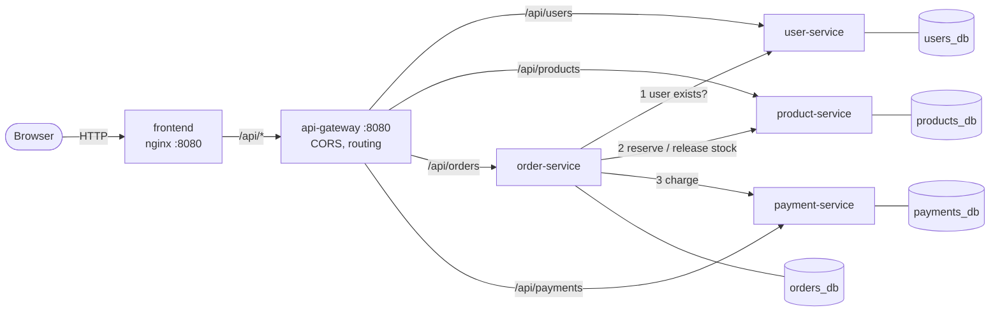
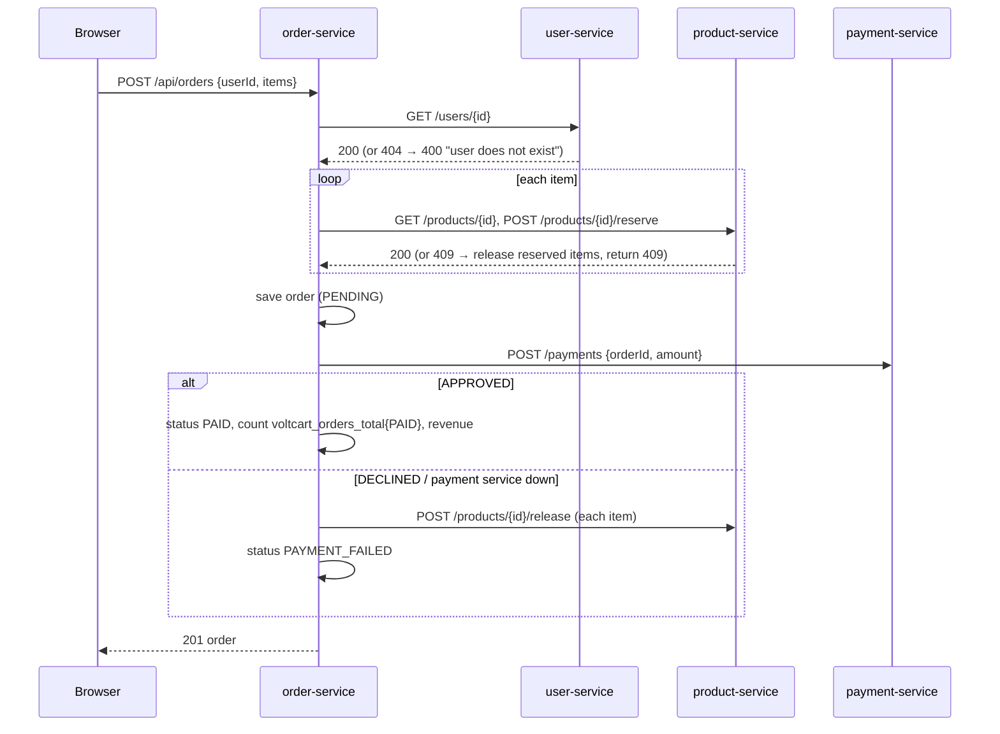
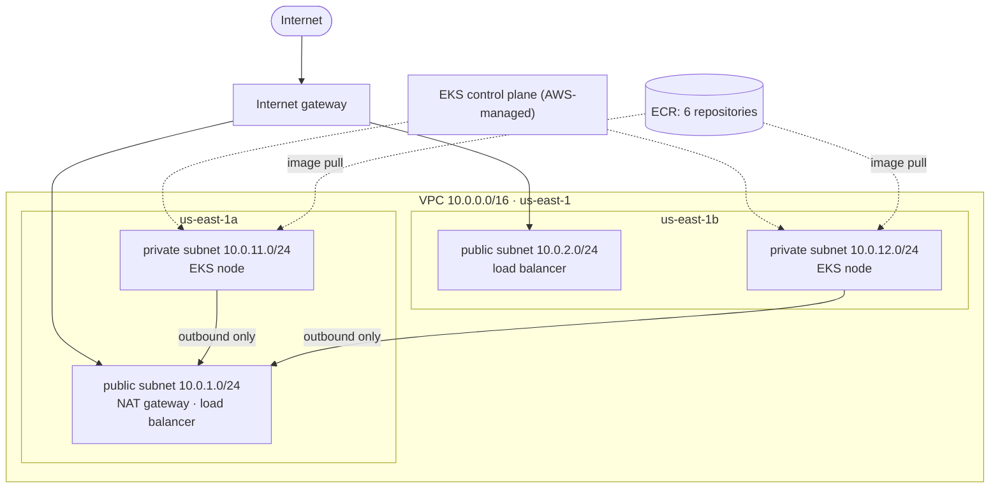
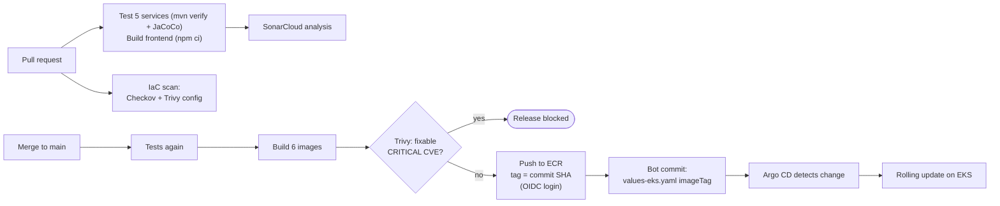

# CloudForge – Architecture

## 1. Overview

CloudForge has three layers:

1. **Application – VoltCart:** a React frontend, an API gateway and four Spring Boot microservices,
   each owning its own PostgreSQL database.
2. **Platform:** Kubernetes (Amazon EKS), packaged with one Helm chart, deployed by Argo CD, observed by
   Prometheus and Grafana.
3. **Delivery pipeline:** GitHub Actions builds, tests and scans every change, pushes images to Amazon
   ECR and records the new version in Git; Argo CD applies it.

All AWS infrastructure is created by Terraform; all Kubernetes resources come from Git.

## 2. Application

| Service | Endpoints (behind `/api`) | Notes |
|---|---|---|
| user-service | `GET/POST /users`, `GET/PUT/DELETE /users/{id}` | |
| product-service | `GET /products?category=`, CRUD, `POST /products/{id}/reserve`, `/release` | Stock is decremented with one atomic SQL `UPDATE … WHERE stock >= :qty`, so two orders can never take the same last item |
| order-service | `POST /orders`, `GET /orders?userId=`, `GET /orders/{id}` | Orchestrates the purchase (below) |
| payment-service | `POST /payments`, `GET /payments/order/{orderId}` | Mock provider: approves ≤ $5,000, declines above (configurable) |

**Every container listens on port 8080** and exposes `/actuator/health/liveness`,
`/actuator/health/readiness` and `/actuator/prometheus`, so one Helm template fits all services.

### How an order is placed

Each service owns its data (**database per service**). There are no distributed transactions; the
order-service compensates instead (releases reserved stock when payment fails) – a simple
*saga* pattern.

## 3. AWS infrastructure (Terraform)

| Terraform module | Creates |
|---|---|
| `vpc`, `subnet` | VPC (DNS enabled), internet gateway, 2 public + 2 private subnets in 2 AZs, route tables; subnet tags so Kubernetes can place load balancers |
| root `main.tf` | NAT gateway + Elastic IP, private route table |
| `eks` | EKS cluster (API + config-map auth, creator is admin), managed node group **2 × m7i-flex.large** (1–3), Pod Identity agent, **EBS CSI driver** |
| `ecr` | 6 repositories (scan on push, keep newest 15 images, `force_delete` for clean teardown) |
| `iam` | Cluster and node roles; EBS CSI role (Pod Identity); **GitHub OIDC provider + CI role** limited to pushing to these 6 repositories, only from `main` |

Design points:
- **Nodes have no public IPs.** They reach the internet only outbound through the NAT gateway; the
  only public entry point is the load balancer in front of the frontend.
- **Two availability zones** for the subnets and nodes.
- **No long-lived AWS keys in CI.** GitHub Actions gets short-lived credentials through OIDC.
- Every resource is tagged `Project=cloudforge`, `ManagedBy=terraform`.

## 4. Kubernetes layout

One Helm chart, `helm/cloudforge`, deploys everything into the `cloudforge` namespace:

| Kind | Objects | Purpose |
|---|---|---|
| Deployment + Service (ClusterIP) | 5 Spring services (generated from **one** template in `spring-services.yaml`) | 2 replicas each on EKS |
| Deployment + Service (LoadBalancer on EKS, NodePort locally) | `frontend` | The only externally reachable component |
| StatefulSet + PVC (gp3, encrypted) | `postgres` | Data survives pod restarts; `PGDATA` in a sub-folder (EBS has `lost+found`) |
| ConfigMap | `postgres-init` | Creates the 4 databases on first start |
| CronJob ×2 + PVC | `postgres-backup` (daily), `postgres-restore` (suspended, manual) | Backup and recovery |
| StorageClass | `gp3` (EKS only) | Encrypted EBS volumes via the CSI driver |
| ServiceMonitor, PrometheusRule, ConfigMap | `cloudforge-services`, `cloudforge-alerts`, `voltcart-dashboard` | Scraping, 7 alerts, Grafana dashboard – only rendered when Prometheus Operator exists |

Every pod has:
- **startup, liveness and readiness probes** (Spring: Actuator health groups; frontend: `/healthz`;
  Postgres: `pg_isready`),
- **CPU, memory and ephemeral-storage requests and limits**,
- a **restricted security context**: non-root user, no privilege escalation, all Linux capabilities
  dropped, read-only root filesystem for the Spring services (writable `/tmp` via `emptyDir`).

Environment-specific settings live in values files: `values-local.yaml` (local images, NodePort 30080)
and `values-eks.yaml` (ECR images, 2 replicas, LoadBalancer, gp3, image tag written by CI).

Supporting components installed in the cluster with Helm: **Argo CD** (`argocd` namespace) and
**kube-prometheus-stack** (`monitoring` namespace, release name `monitoring`).

## 5. CI/CD and GitOps

- **Pull requests** run tests, SonarCloud and the IaC scans – nothing is built for AWS or deployed.
- **Merging to `main`** builds all 6 images, scans each with Trivy (the **security gate**), pushes
  them to ECR tagged with the commit SHA, and commits that tag into `helm/cloudforge/values-eks.yaml`.
- **Argo CD** watches `main`. With `automated: {prune: true, selfHeal: true}` it applies every change
  in Git and reverts manual changes made directly in the cluster. Git is the single source of truth –
  rollback is `git revert`.
- Supply chain: all third-party actions are pinned to commit SHAs, Checkov runs from a digest-pinned
  image, the frontend installs from a lock file with install scripts disabled, Dependabot proposes
  updates weekly.

## 6. Observability

- Every Spring service exposes Micrometer metrics: HTTP request counts and **latency histograms**
  (for p95), JVM memory, plus business metrics from order-service:
  `voltcart_orders_total{status}` and `voltcart_revenue_total`.
- The chart's **ServiceMonitor** makes Prometheus scrape all five services every 30 s.
- **Grafana** loads the *VoltCart – Service Overview* dashboard from a ConfigMap (dashboard as code).
- **PrometheusRule** `cloudforge-alerts` defines 7 alerts: availability, Postgres, scrape failures,
  crash loops, 5xx error rate, p95 latency, payment failures.

Details: [operations.md](operations.md).

## 7. Key design decisions

| Decision | Why | Trade-off |
|---|---|---|
| One Helm chart with a generic Spring template | Adding a service = a few lines in `values.yaml`; consistent probes, limits and security for all | Less per-service flexibility |
| Database per service in one Postgres instance | Clear data ownership, cheap | One Postgres pod; production would use a managed database (Amazon RDS) with Multi-AZ |
| Postgres in Kubernetes with EBS + backup CronJob | Demonstrates StatefulSets, PVCs and backup/restore | Backups live in the same cluster; production would copy them to S3 |
| GitOps with image tag committed by CI | Every deployed version is traceable to a commit; rollback via Git | One extra bot commit per release |
| OIDC for CI → AWS | No stored AWS keys | Role trust is limited to `main` of this repository |
| m7i-flex.large nodes | The account is on the AWS Free Tier plan (t3.large not allowed, see Issues #7) | Max 29 pods per node |
| HTTP only on the load balancer | No domain/certificate in a course project | Production: Route 53 domain + ACM certificate (HTTPS) |
